

<a href="https://github.com/Tayyab-Ali-786"></a>

&nbsp;
&nbsp;
&nbsp;

<a href="#projects"><b>PROJECTS</b></a> &nbsp;·&nbsp; <a href="#experience"><b>EXPERIENCE</b></a> &nbsp;·&nbsp; <a href="#about"><b>ABOUT</b></a> &nbsp;·&nbsp; <a href="#stack"><b>STACK</b></a> &nbsp;·&nbsp; <a href="#education"><b>EDUCATION</b></a> &nbsp;·&nbsp; <a href="#activity"><b>ACTIVITY</b></a>

<a href="https://github.com/Tayyab-Ali-786/web_stream"></a>

A Go streaming server on **Pion WebRTC** that ingests H.264 from **GStreamer** over UDP/RTP and broadcasts it to browsers. Its **Frame-Aware Metronome** assembles complete access units before bursting RTP, which took latency from **~600ms to under 33ms**. It also has a packet interceptor and jitter buffer. The Next.js viewer's `useStreamSession` hook owns the whole WebRTC lifecycle: SDP signaling, ICE queuing, adaptive jitter buffering, codec negotiation, freeze detection and auto-reconnect.

[**Server — web_stream ↗︎**](https://github.com/Tayyab-Ali-786/web_stream) &nbsp;·&nbsp; [**Viewer — web ↗︎**](https://github.com/Tayyab-Ali-786/web)

<table>
<tr>
<td width="50%" valign="top">
<a href="https://ajaia-docs-mpvh.onrender.com"></a>
 Create, format, autosave and share docs as viewer or editor. Version numbers on every save give a <b>409 "Reload"</b> instead of silent overwrites, plus full version history with restore, <code>.docx</code>/<code>.md</code> import and Markdown export. Postgres in prod, PGlite (WASM) in tests.
 <a href="https://ajaia-docs-mpvh.onrender.com"><b>Live ↗︎</b></a> &nbsp;·&nbsp; <a href="https://github.com/Tayyab-Ali-786/ajaia-docs"><b>Code ↗︎</b></a>
</td>
<td width="50%" valign="top">
<a href="https://chattify-seven.vercel.app"></a>
 Peer-to-peer chat rooms over WebRTC data channels, end-to-end encrypted with the Web Crypto API. Each peer derives a shared key via <b>ECDH P-256</b> and encrypts messages with <b>AES-GCM</b>, so the server never sees plaintext. Includes a JWT auth server.
 <a href="https://chattify-seven.vercel.app"><b>Live ↗︎</b></a> &nbsp;·&nbsp; <a href="https://github.com/Tayyab-Ali-786/Chattify"><b>Code ↗︎</b></a>
</td>
</tr>
<tr>
<td width="50%" valign="top">
<a href="https://gdc-solution.vercel.app"></a>
 An AI layer that watches founders' daily decisions and flags "coordination gaps", like sales promising a feature engineering just cut. Gemini checks each new action against Firestore history, and alerts land live via <code>onSnapshot</code>. Placed <b>5th of 17</b> at the Google AI Hackathon.
 <a href="https://gdc-solution.vercel.app"><b>Live ↗︎</b></a> &nbsp;·&nbsp; <a href="https://github.com/Tayyab-Ali-786/GDC_Solution"><b>Code ↗︎</b></a>
</td>
<td width="50%" valign="top">
<a href="https://github.com/Tayyab-Ali-786/ShippiFy"></a>
 A MERN e-commerce store with product categories, auth and password reset, cart management, Cloudinary images and <b>Stripe</b> checkout. React + TypeScript client with Tailwind and React Query.
 <a href="https://github.com/Tayyab-Ali-786/ShippiFy"><b>Code ↗︎</b></a>
</td>
</tr>
</table>

**More projects**

| Project | What it is | Built with | Links |
|:--|:--|:--|:--|
| **Prepify** | AI mock interviews with a real-time voice agent | Next.js · OpenAI · Vapi | [Live](https://ai-mock-interview-lake-two.vercel.app) · [Code](https://github.com/Tayyab-Ali-786/Ai_Mock_Interview) |
| **FIFA Match Analytics** | Stats dashboard over 128 World Cup matches with a linear-regression goal predictor | Next.js · Node · Python | [Code](https://github.com/Tayyab-Ali-786/Data_Analyzer) |
| **Smart Campus Graph** | Campus navigation and door-access system on weighted graphs | C++ | [Code](https://github.com/Tayyab-Ali-786/SmartCampusGraphSystem) |
| **Brick Buster** | Breakout clone written in x86 Assembly | Assembly | [Code](https://github.com/Tayyab-Ali-786/Brick-Buster) |


**Full-Stack & Streaming Engineer · Huvio AI.** I took over a gRPC-based WebRTC pipeline that had been broken for over a month. It had no reconnect logic, hardcoded TURN credentials, drip-fed packets and zero observability. I redesigned the pacing, fixed 7 production bugs (IDR detection, buffer depth, auth middleware, auto-reconnect and more), and added a gRPC simulator for testing against production frames.


**Lead Full-Stack Developer · JayTech Elite Firm.** I built **SmokeScreen V2** end to end on my own: frontend, backend and database, with voice cloning, photo-to-video, AI photo editing and a low-latency face-swap pipeline. I also shipped the Electron desktop app, migrated V1 users to a new Supabase database, and integrated Flutterwave, Squadco and crypto payments. It's at **~25,000 users** and growing.

### I build the parts of a product where milliseconds matter — live video, AI pipelines, and the SaaS around them.

I'm a **Full-Stack Developer and Real-Time Video Streaming Engineer**. One side of my work is **WebRTC, gRPC and Go** pipelines. The other is **Next.js, Node.js and Supabase** products, plus the payments, GPU infra and production debugging it takes to ship them.

📍 Lahore / Faisalabad, Pakistan &nbsp;·&nbsp; 🎓 BSCS @ FAST-NUCES &nbsp;·&nbsp; ⚡ Top Rated on Upwork &nbsp;·&nbsp; 🌍 Open to remote roles

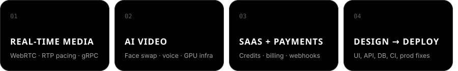

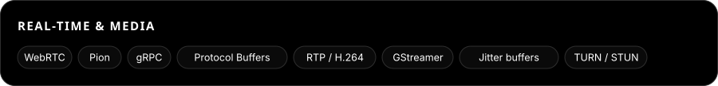

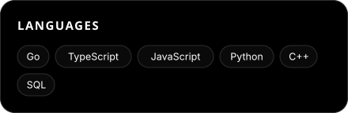
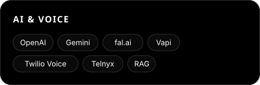

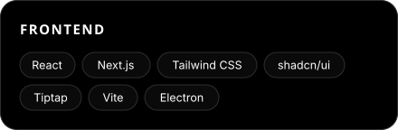
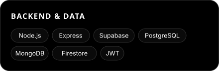

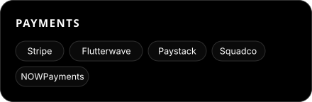
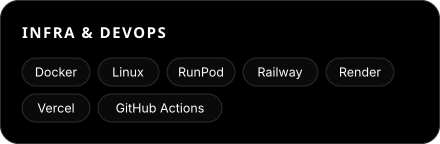

### 🎓 BS Computer Science — FAST-NUCES, Chiniot-Faisalabad Campus
`Batch Fall-2024`

| Program | Issuer |
|:--|:--|
| **Generative AI Training — Cohort 3** | Pak Angels |
| **Technical Internship — January 2026 Batch** | CodeAlpha |
| **Google AI Hackathon — 5th of 17 teams** | FAST-NUCES CFD |

<picture>
  <source media="(prefers-color-scheme: dark)" srcset="https://raw.githubusercontent.com/Tayyab-Ali-786/Tayyab-Ali-786/output/snake-dark.svg"/>
  
</picture>

